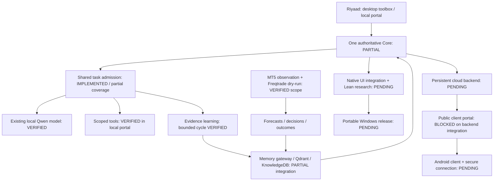

# Niblit build map and four-day planning workbook

Prepared 31 October 2026, Africa/Johannesburg (UTC+2).
Owner: Riyaad / Enginehead Software Development.

## Where we are

Niblit is a working local research/demo-trading setup with several tested pieces.
It is not yet one fully accepted, portable desktop release with every brain,
manager, UI route and hosted client connected. The biggest remaining job is
integration and verification, rather than adding more named engines.

This map summarizes the recorded implementation and acceptance evidence, not a
fresh audit of every file or a promise of continuous service. Working source,
running services, the older executable and public hosting are separate states.
No percentage is assigned: a tested helper and a complete release are not equal
units of progress.

Legend: **Verified** = a specific implemented workflow was checked;
**Partial** = useful pieces exist but full integration/acceptance is outstanding;
**Staged** = source/config exists but not activated or accepted;
**Planned** = design remains; **Deferred** = owner paused the work.

## System picture

Desired complete feedback loop:
**observe → retrieve evidence → decide → check permissions/risk → act → measure
the actual result → save with provenance → evaluate the next decision**.
One task owns this loop until it finishes; model-generated claims do not become
verified facts simply by being saved.

## Component-by-component status

| Area | Current evidence / status | What makes it complete |
|---|---|---|
| Local Qwen inference | Verified existing authenticated GGUF service, one slot; no routine paid fallback | Full desktop chat and all native producers use the same governed request path |
| One-task control | Verified shared durable admission, busy rejection, timeout ownership/quarantine, portal/tutor integration | Audit remaining legacy/Core/Cloud callers; prove no overlapping work across actual full boot |
| Native Core and Cloud | Partial; missing LocalBrain route repaired in source | One boot owner, correct model routing, no duplicate Core/model processes; real UI-to-Core-to-model reply |
| Autonomous learning | Partial; bounded local-evidence ALE cycle and worker lifecycle tested | Actual Core boot, native controls, separate curricula and measured improvement; remaining producers integrated |
| Cognition / managers | Partial existing modules and contracts | Inspect each manager's inputs, decisions, outcomes and ownership; remove competing scheduling and unsupported health claims |
| Memory | Verified gateway recall and unverified observation flow; Qdrant container available | End-to-end native/portal/trading isolation, deduplication, correction lineage, evaluated recall, backup AND restore acceptance |
| Local-model tools | Verified scoped source/docs reads and inert proposals in local portal | Same capabilities through native UI; isolated code tests/review/rollback before applying generated changes |
| PDF attachments / Ctrl+K | Earlier problems identified; release acceptance outstanding in current delivery plan | Real PDF question with page references; command catalogue and each supported action tested from native UI |
| MT5 | Verified connection and EURUSD auto observation; bounded demo/order/close code exists | Fresh end-to-end demo entry/exit receipts, restart/reconciliation and cost-aware reporting across the chosen strategy |
| Freqtrade | Verified NiblitLabManager dry-run, adaptive-exit callback checks, durable new-entry context; resumed existing run | Forward outcome review, attribution to exact strategy/version, restart/stop behavior and full memory feedback acceptance |
| Prediction/comparer | Verified immutable forecasts, later scoring and bounded shadow predictors | Enough settled outcomes, untouched evaluation periods and cost-aware comparisons; currently advisory |
| Finance/trading expertise | Partial research/memory/strategy components | Evidence-based curriculum and scored tests; demonstrate better decisions on unseen data rather than claim expertise from fact counts |
| Micro trading | Staged separate NiblitMicroDemo; disabled without valid bounded session | Separate profile/database, session UI, backtest and forward tests with real costs; not the active manager |
| Seconds trading | Planned observation/latency prototype | Real ticks/order book, freshness/gap checks, measured costs and execution latency before bounded demo orders |
| Outcome-planning layer | Planned scoped decision support | Versioned allowed settings, objectives, constraints and measured results; no authority to change risk or control market prices |
| Native toolbox / Lean | Partial older Tauri UI; new desks not all exposed | Shared real APIs and identity, all new routes reachable, one genuine supported Lean research/backtest task |
| Path Manager / install | Partial; per-user Docker discovery and bounded launcher/readiness checks verified | Portable application-data paths, dependency manifest, clean-user/VM install and recovery without private bundled data |
| Windows executable | Older builds exist; recent source changes not repackaged | Dated build, hashes, licenses, migration/rollback and complete cold-start acceptance |
| Local client portal | Verified login/workspaces/admin pilot tiers, local tools, health and SQLite backup | Restore drill, account/session lifecycle acceptance and cloud-ready data/response adapters |
| Public client portal | Incomplete; Vercel production fails missing FastAPI entrypoint | Durable backend/database + reachable inference, then signup→approval→login→isolated response→restart/restore |
| Company website | Verified company Vercel URL | Marketing claims/downloads match tested capabilities; real release artifact before advertising a ready download |
| Custom domain | Vercel attachment complete; Namecheap DNS parked; DEFERRED by owner | Resume only when requested; decide renewal/use before DNS work |
| Android / tunnel | Staged HTTPS/capability configuration; no live tunnel or APK | Persistent reachable backend, toolchain choice, installed debug APK and real Wi-Fi/mobile-network acceptance |
| OS/desktop companion | Partial stubs/tools; unrestricted self-improvement not delivered | Scoped file/navigation actions, visible traces, safe cancellation and reviewed changes integrated with scheduler |
| Home cameras | Future separate workstream | Camera ingestion, object/activity events, retention and consent-based enrollment; no identification of unknown passersby through social profiles |

## What the next four days actually collect

- Freqtrade can collect simulated trade outcomes under its existing strategy.
  This is a demo record, not a funded portfolio or proof of a profitable edge.
- MT5 observation collects available market data and research signals. The current
  observation session does not place orders. Closed markets can mean no new ticks.
- Forecasts can be evaluated only after their target periods have elapsed.
- Local-model continuous idle study was not newly started. Data gathering does
  not automatically train weights or prove greater intelligence.
- Keep the PC awake, Docker running and internet available. Check the dashboards
  after reboot; no cloud uptime guarantee or unattended monitoring by Codex exists.
- Preserve data and strategy settings while collecting a baseline. If settings
  change, record time/version so before/after results remain distinguishable.

## Four-day discussion workbook

### Day 1 — Define the product and the next release

Choose the first customer/use case: personal programmer toolbox, trading research
assistant, or hosted client assistant. Other capabilities may stay available, but
one release needs one main success criterion.

Write: “The next release is complete when I can __________ from a fresh start.”
List the five daily actions you most want to work without troubleshooting.

### Day 2 — Review outcomes and learning quality

Record: app/strategy version, demo mode, closed trade count, net P/L after reported
costs, drawdown, entry/exit reasons, missing/duplicate outcomes and disconnects.
Small samples are observations, not reasons to increase risk. Keep the baseline.

Prepare ten repeatable questions: three finance, three code, three runtime/memory,
one PDF attachment. For each, write the expected evidence and what UNKNOWN should
look like. Retest these after updates to measure retrieval and behavior changes.

### Day 3 — Decide deployment and control

Decide: personal desktop first or paid public service first; monthly hosting
budget; whether the PC must work offline; who can access shared/private data;
which actions are automatic, demo-only, proposal-only or require your confirmation.
Vercel frontend and a long-running model/backend are different deployment needs.
No hosting purchase or paid inference commitment has been made by this plan.

### Day 4 — Freeze the next-week backlog

Sort requests into Must / Next / Later. Give every Must a visible acceptance test.
Choose one release target; defer additional engines until integration passes.
Bring failure screenshots/timestamps and example questions, without credentials.

| Decision | Your preferred answer | Why / acceptance condition |
|---|---|---|
| First release's main purpose | To discuss | Five daily workflows |
| Desktop reliability vs public hosting priority | To discuss | One primary milestone |
| Default AI: local only / explicit paid escalation | Local routine work; paid loops off today | Visible spending and model identity |
| Idle study budget and schedule | Current bounded profile, no new recurring study | One task, CPU/RAM ceiling, stop behavior |
| Trading development priority | Existing dry-run baseline first | Cost-aware entry/exit outcome report |
| MT5 demo session policy | Bounded, explicit starts today | Stop/expiry and no hidden reentry |
| Hosting budget/provider | No server selected or purchased | Persistent storage and restore |
| Android first functions | To discuss | Login, view data, secure API response |
| Domain renewal/use | Deferred | Decide before resuming DNS |

## Recommended next-week execution order

1. **Runtime integration milestone.** Recheck processes/modes, wire remaining
   native callers into one scheduler, then prove actual UI→Core→local inference
   →evidence/memory→response. Stop/restart/timeout acceptance is mandatory.
2. **Learning and trade evidence milestone.** Review the four-day baseline, verify
   one actual trade outcome reaches recall, and complete one evaluated learning
   cycle per domain. Preserve unverified status and source lineage.
3. **Native release milestone.** Expose real health/memory/learning/market views,
   verify PDF/Ctrl+K, package a dated release and test cold start/rollback. Fix
   blockers before opening more feature work.
4. **Public service milestone.** Select durable hosting, complete data/inference
   adapters and isolated-client acceptance, then publish functioning signup/chat.
5. **Android and faster-trading experiments.** Build on the accepted API/release;
   use separate profiles and measurable latency/cost criteria.

This sequence is dependency-driven, not a promise that all five milestones fit
one week's quota. If public hosting becomes the chosen priority, move milestone 4
ahead of desktop polish, while preserving the runtime/data isolation gates.

## Starting instructions for the next coding session

Read AGENTS.md, this map, NEXT_SESSION_CHECKPOINT.md and INTEGRATED_DELIVERY_PLAN.md.
Recheck live identities/modes; do not trust historical ports as current proof.
Preserve dirty source, private .env, personal databases and existing positions.
Start with one acceptance milestone and one complete feedback loop. No paid tests,
strategy switches, risk increases, unrestricted auto-edits or blanket rebuild.
Finish each increment with tests, observed workflow, limitations and rollback.

## What “Runtime Broker” means

If you mean Windows Task Manager's Runtime Broker, Microsoft describes it as a
Windows process that helps manage device permissions for Microsoft Store apps.
It is separate from Niblit's task admission, Core runtime and broker/exchange
connections. Seeing that process does not mean Niblit is trading or learning.
This map does not identify or diagnose any particular process on your PC.

Source: https://support.microsoft.com/en-us/windows/experience/runtime-broker-is-using-too-much-memory

## Supporting records

- INTEGRATED_DELIVERY_PLAN.md — detailed P0–P8 implementation and acceptance.
- NEXT_SESSION_CHECKPOINT.md — latest changes and resume instructions.
- FOUR_DAY_RUN.md — operational handoff and recovery.
- DOMAIN_CONNECTION_STATUS.md — domain attachment / deferred DNS work.
- SHARED_TASK_ADMISSION.md and NATIVE_ALE_LOCAL_PROFILE.md — request ownership
  and bounded learning contracts.
