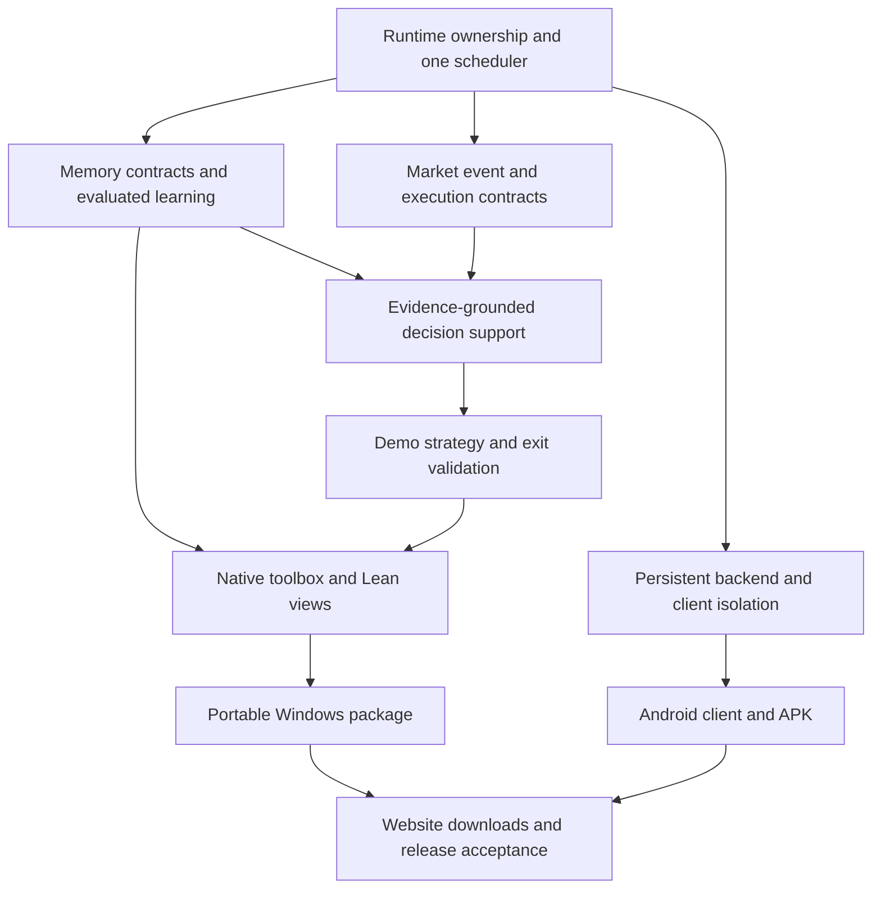

# Niblit integrated delivery plan

Owner: Riyaad / Enginehead Software Development. Updated 30 October 2026 (UTC+2).
This is the current implementation handoff, not a claim these deliverables exist.
Read alongside NEXT_SESSION_CHECKPOINT.md and the historical NIBLIT_MASTER_PLAN.md.

## Standing requirements

- One active task and one complete feedback loop: observe -> recall -> decide ->
  authorize -> act -> measure -> remember -> evaluate. No independent swarms of
  local-model requests. Existing services must be reused rather than duplicated.
- Preserve private .env, user databases, open positions and dirty source. Never
  bundle credentials or personal memory into a public release or APK.
- Local models for routine work; preserve OPENAI_MODEL=gpt-6-astra. Paid background
  work remains off. Do not spend credits to validate ordinary plumbing.
- Demo/dry-run trading only for this delivery. Existing running state is not
  permission to switch strategy, start another engine or expand risk limits.
- Saved claims, model suggestions, source evidence and verified facts stay distinct.
  Better forecast error is not demonstrated profit; memory counts are not expertise.
- Each task leaves code, relevant checks, an actual workflow acceptance where
  possible, limitations, rollback instructions and an updated checkpoint.

## Current baseline

| Component | Observed state | Important limitation |
|---|---|---|
| Market Desk 8767 | MT5 EURUSD observation; demo controls and journals | Current older positions not adopted by new exit rules |
| Freqtrade | NiblitLabManager dry-run running; latest reload retained 3 positions | New entry contexts only; do not switch its active strategy |
| Predictive comparer | Saved forecasts, later scoring, bounded research selection | Advisory; no validated execution edge |
| Adaptive exits | MT5 new bounded demo entries; native Freqtrade callbacks loaded | Experimental; costs/gaps can erase price gains |
| Micro strategy | NiblitMicroDemo staged, native import/disabled-session check passed | No backtest, active profile, session UI or seconds-based execution |
| Local portal 8769 | Owner research tools, drafts, local Qwen, study controls | Local single-task gate does not yet govern every legacy inference path |
| Memory gateway 8772 | Scoped native recall and unverified episodic observations | Existing Core/ALE lifecycle integration still incomplete |
| Windows desktop UI | Existing Tauri shell in sibling niblit-ui | New desks are not all integrated native routes |
| Hosted clients | Local portal and private GitHub repository exist | Production portal/database/tenant acceptance incomplete |
| Company website | enginehead-company.vercel.app published | Verify requested enginehsd.site/www domain move and DNS |
| Android | buildozer.spec, Android HAL and dependency profile exist | These are not proof of an installable, working APK |

The latest changes are local source and running Python services. They have NOT
all been incorporated into a newly packaged Windows executable.

## Dependency map

## Work packages, in implementation order

### P0 — Inventory and recoverable baseline

Inspect applicable AGENTS.md in each sibling repository. Record active process,
port, source root, data path, model identity and owning manager. Back up mutable
configuration/databases using existing consistent backup tools. Separate source,
running services and frozen builds in the inventory. Do not mass-stage dirty files.

Acceptance: a small manifest identifies what is running and what can be rolled
back. This task must not restart trading or initialize another Core/KnowledgeDB.

### P1 — One runtime scheduler and local inference admission

Targets: modules/runtime_router_v2.py, modules/local_brain.py,
modules/llm_tool_loop.py, modules/runtime_resource_manager.py,
modules/autonomous_learning_engine.py, modules/portal_model.py and existing
Core lifecycle ownership in core/runtime_manager.py and niblit_core.py.

Trace the actual call sites before changing them. Use one admission authority
across processes, not unrelated locks in separate apps. Hold task ownership for
the complete feedback loop, including tool observations and memory writes.
Interactive work takes priority over idle study. Busy requests return an honest
status; no unbounded queue. Bound context, output, calls, wall time and CPU/RAM.
Stop prevents new work; timeout must not silently launch another request while
the first still runs. A restart defaults to disarmed learning/execution.

Acceptance: concurrent portal/Core/ALE requests produce at most one active local
generation; no hidden paid fallback; busy/stop/timeout/crash tests pass. Actual
UI -> authoritative Core -> local model -> memory -> response round trip works.

### P2 — Memory, predictions and domain knowledge

Reuse modules/memory_laboratory/{gateway,runtime,context,contracts,consolidation}.py
and the existing KnowledgeDB projection. Add explicit records for forecasts,
their issue-time inputs/version, realized targets, errors, pattern hypotheses,
exit rationale and net execution outcomes. Preserve venue/account/mode/timeframe
and point-in-time lineage. Revisions append corrections rather than rewrite
earlier predictions. Exclude model reflections from self-corroborating evidence.

Treat the requested influencer layer as an outcome-planning/decision-support
layer over Niblit's own authorized actions and settings. Record objective,
available actions, constraints, expected benefit, uncertainty and observed result.
It cannot grant permissions, alter risk caps or claim control over market prices.

Acceptance: retrieval answers a real question using correct source citations;
unverified predictions remain unverified; finance/software/client namespaces are
isolated; duplicate imports are idempotent; stale/revised data is visible.

### P3 — Wire the native learning and brain components

Reuse the existing ALE, cognition/knowledge-gap layers, LocalBrain, trading brain
and manager contracts. Define one owner for scheduling and one owner for each
domain's evidence/evaluation; do not create another generic brain orchestrator.

Niblit selects one gap, retrieves evidence, asks one local model, assesses the
answer against evidence, saves a candidate or gap, then measures the next attempt.
Separate finance, code/software and runtime/self-knowledge curricula. Track
retrieval success, citation support, uncertainty, usefulness and regression.
Do not label self-assessment as independent truth verification or weight training.

Local models see a bounded capability/context description of Niblit and scoped
tools. Code improvement follows proposal -> isolated worktree -> bounded checks ->
review -> reversible application -> outcome record. No unrestricted self-editing,
shell, dependency installation or automatic deployment from model output.

Acceptance: actual native UI and idle study share the scheduler; one evaluated
learning cycle completes with a trace; failed/citationless answers remain gaps;
restart recovery and resource contention are tested.

### P4 — Complete trading parity and cost-aware micro experiments

Existing targets: modules/{demo_autotrader,position_exit_policy,strategy_research,
online_market_study,freqtrade_research,trading_desk}.py; deploy/freqtrade-lab/;
sibling freqtrade and niblit-lean-algos adapters.

1. Validate MT5/Freqtrade entry and close receipts, adaptive exit attribution,
   partial/unknown delivery reconciliation and net costs.
2. Backtest and forward-test staged NiblitMicroDemo in a SEPARATE dry-run profile
   and database. One open position; five entries/ten-minute session; explicit
   start/stop/expiry; minimum stake never rounded above the cap. Add session UI.
3. Build a seconds-based OBSERVATION prototype using real timestamped ticks or
   order-book events, sequence/gap checks and a latency ledger. Measure signal ->
   submission -> acknowledgement -> fill. No faster polling of stale M1 candles.
4. Simulate spread, fees, slippage, rate limits, partial fills and disconnects;
   compare with an unchanged baseline and untouched forward periods. Only then
   consider a bounded demo execution adapter for seconds-based scalping.
5. Keep tuning allowlisted and versioned. Never let the predictor adjust leverage,
   money limits or permissions. No guaranteed profitability or HFT claim.

Acceptance: reproducible cost-aware reports and broker/engine demo receipts;
bounded sessions cannot churn/reenter after Stop; no unknown position adoption;
no model inference inside the fast execution path. Preserve current strategies
until a separately reviewed profile is ready.

### P5 — Native UI tabs and Lean-algos workspace

Targets: sibling niblit-ui/src/App.tsx, its existing route/components/API layer,
Niblit's authoritative server endpoints and sibling niblit-lean-algos.

Expose coherent native routes for Market Desk, Strategy Lab, Forecast/Comparer,
Position Risk/Exits, Memory Desk, Learning/Gaps, Tools/Proposals and Runtime Health.
Share existing APIs and session identity; do not embed unauthenticated management
ports or expose secrets. Avoid duplicate controls that disagree on runtime state.

Lean UI: actual adapter/process health, registered algorithms, parameter schema,
data-source freshness, research/backtest jobs, progress/logs, results and trade
lineage. Start with read-only inspection and bounded backtests. Clearly distinguish
QuantConnect LEAN, Lean theorem-prover tooling and similarly named legacy modules
after inspecting the actual repository. Existing filenames are not proof of a
working trading engine. No fabricated backtest results or live controls.

Acceptance: user can navigate each view from the native toolbox, see genuine
service data, recover from offline services, and run one actual bounded Lean
research task where the installed backend supports it.

### P6 — Repackage Windows and portable environment

Targets: Niblit/niblit.spec, niblit-ui/src-tauri/tauri.conf.json, existing build/
verification scripts and Path Manager work. Verify framework/package versions.
Use configurable resolved paths, application data outside release directories,
one boot owner and explicit service readiness. Preserve old releases for rollback.

Create a dated release with source/dependency manifest, hashes, license notices,
startup/migration logs and clear optional Docker/model prerequisites. Never pack
personal keys, account databases, trading configuration or model weights without
an explicit redistribution decision. Website download links must target real
verified artifacts, not placeholders.

Acceptance: cold start, model reply, PDF question with page citations, Ctrl+K
commands, new UI routes, memory retrieval, restart and a clean Windows-user/VM
installation. Only then call the repackaged release ready.

### P7 — Persistent cloud backend and public client deployment

Reuse the standalone niblit-client-portal repository and existing Vercel project.
Inspect current Vercel/Turso/domain state; prior auth blockers may be stale.
Vercel serves company/client web apps. Select a suitable persistent compute host
for long-running Niblit/local model/container services; no server has been bought.
Provision durable data/backup/restore and a real cloud database adapter before
deploying sessions into ephemeral functions. Never expose Docker, Qdrant or broker
management directly to the public internet.

Provide authenticated API contracts, scoped roles, session revocation, tenant
isolation, quotas, request admission, TLS, audit, health and recovery. Reuse the
already-authorized OpenAI connector only where explicitly configured; no paid
testing/background spend. Private desktop memory must not become client memory.
Verify enginehsd.site/www placement on the Enginehead company project, with the
client portal linked as a separate application.

Acceptance: production signup -> owner approval -> login -> isolated chat ->
persisted response -> restart/restore; client A cannot access client B or desktop
tools. No purchases, billing activation or new funded trading authority implied.

### P8 — Android configuration and app

First deliverable: a secure Android CLIENT for the same API and views. Heavy local
models, Windows MT5 and Docker services stay on the PC/persistent backend. Offline
Android-native inference is a later, separate capability if hardware supports it.

Inspect niblit-ui's Tauri version, Android toolchain support, Niblit/buildozer.spec,
requirements/android.txt and kernel/hal/android.py before selecting the app shell.
Reuse the existing frontend where practical; do not assume old Python/proot
requirements constitute APK readiness. Produce an environment report for JDK,
Android SDK/NDK, build tooling, device/emulator and signing availability.

Implement login, secure session storage, TLS endpoint configuration, lifecycle
reconnection, responsive toolbox/memory/learning/market views, read-only defaults
and explicit authorized controls. Never embed API/broker/private service keys.
Use OS-backed secret storage; notifications are permission-based and opt-in.

Acceptance: installable debug APK on an emulator/physical device, login -> API ->
real memory/model response, background/resume/logout/revocation tests, no cleartext
production endpoint. Release signing belongs to the owner; a debug APK is not a
production-signed release. Produce build hashes and installation instructions.

## First next-session instruction

Read AGENTS.md, this plan and NEXT_SESSION_CHECKPOINT.md. Recheck active service
identities and trading modes without dumping credentials. Begin P0/P1; prove one
cross-component admission/feedback loop before opening another major work package.
Do not rebuild everything, start micro trading or deploy a public backend merely
because this plan lists them. Update this plan with concrete evidence after each
completed package, then proceed to the next dependency.

## Definition of complete

A packaged Windows app and tested Android client use one coherent, authenticated
runtime and memory API; local models operate through one governed admission/tool
path; native UI exposes real service state; learning is measured; demo trading
has attributable outcomes; hosting survives restart/restore. No component is called
complete on the strength of a stub, source import, open port or screenshot alone.

## Android tunnel implementation checkpoint

See ANDROID_REMOTE_ACCESS.md. Opt-in named-tunnel Compose profile, HTTPS-only Android configuration and tested remote-client Host/Origin/cookie/capability boundary are now implemented. Tunnel account, token, verified DNS route and phone-network acceptance remain outstanding. No public tunnel was started. Remote requests reuse the existing portal task lock; this is one concrete part of P1/P7/P8, not completion of the full native scheduler or Android app.
