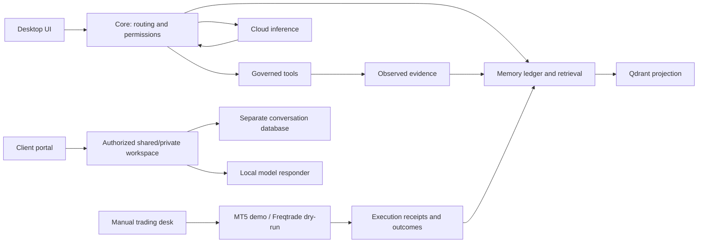

# Niblit: what runs, how it connects, and why

Source review: 29 October 2026. This describes the current local checkout, not a
claim that every function is healthy or present in the last packaged executable.
Start with [the delivery plan](NIBLIT_MASTER_PLAN.md), [request audit](request-audit/README.md)
and [source atlas](code-atlas/README.md).

## The system in ordinary language

Niblit is several cooperating programs. The desktop UI is the control panel.
Core decides which requests and tools are permitted. Cloud runs selected models.
Memory retains evidence so later questions can retrieve it. Trading adapters
observe a particular market/account and pass reviewed actions to its actual engine.
The client portal is a separate, restricted service; it does not expose your PC.

The diagram is a boundary map. It does not assert that every possible event or
learning outcome already makes a complete round trip.

## Read these components in this order

| Component | What it does | How | Why it exists / current limit |
|---|---|---|---|
| `scripts/launch-toolbox.py` | Starts the tested desktop profile | Resolves an explicit release folder, environment and existing memory paths | Preserves the user's data; its dated release path is not a portable installer |
| `main.py`, `lifecycle_engine.py` | Own startup and lifetime | Initialize Core and managed services, then wait for UI/runtime shutdown | A visible window must not outlive the backend that serves it; fallback classes need honest degraded status |
| `niblit_core.py` | Connects many subsystems and commands | Constructs services, registers handlers, bridges events and dispatches requests | Central authority, but a large coupling hotspot; change one boundary at a time |
| `modules/niblit_runtime.py` | Runtime structures and module/service state | Tracks registered components and event relationships | Registration is discovery, not successful operation |
| `niblit_router.py`, command registry | Maps user commands to handlers | Recognizes command families, arguments and governed bindings | Ctrl+K and command pages should show actual availability, not promise execution for every label |
| `modules/llm_tool_loop.py` | Runs model/tool interactions | Sends context to Cloud, validates model tool requests through the executor, returns evidence | The model requests actions; it does not grant itself permissions |
| `modules/workspace_tools.py`, `chat_attachments.py` | Read authorized files and attachments | Validate paths, parse supported content, retain lines/pages and bounds | File names and raw PDF bytes are not usable document context; scanned PDFs still need OCR |
| `niblit_memory`, `modules/llm_chat_memory.py` | Preserve legacy knowledge and completed conversations | Canonical compatibility writer plus SQLite paired exchanges | Existing knowledge and history must survive upgrades |
| `modules/memory_laboratory/runtime.py` | Queue evidence for memory projection | Durable outbox, bounded worker, leases, embeddings and retry | Qdrant downtime must not silently erase source evidence |
| `modules/memory_laboratory/gateway.py` | Govern ingestion/retrieval | Validate scope and permission, store source ledger, project/search | Qdrant is a searchable projection; it is not the only copy of truth |
| `modules/memory_laboratory/market.py` | Compare numeric market states | Separate venue/symbol/interval/mode/features; as-of availability | Prevent cross-market matches and hindsight leakage |
| `modules/trading_brain.py` | Build features and suggest decisions | Fetch candles, store/retrieve observations, apply current rules | Similarity is not proven profitability; current journal adapter identifies Binance |
| `modules/mt5_bridge.py`, `mt5_orders.py` | Observe and review demo execution | Desktop IPC, freshness/account checks, durable intent before one submission | Uncertain delivery must not trigger a duplicate order; Windows terminal required |
| `modules/trading_desk.py` | Human market/order interface | Fixed adapters, reviewed tickets, receipts and reconciliation | Demo/dry-run only; not a funded autonomous trading service |
| `modules/autonomous_learning_engine.py` | Coordinate learning/research phases | Managed worker, phase sequence, bounded jobs and statistics | Active research records and its reported running state currently need reconciliation |
| `modules/local_brain.py` | Older inference/trainer compatibility | Some classes delegate; deprecated trainer methods explicitly do nothing | Do not mistake compatibility APIs for model training |
| `modules/server_manager.py` | Client accounts and conversations | Hashed passwords, cookies, CSRF, shared session and local inference | Isolated from desktop tools; cloud hosting and live model response still unverified |
| `modules/portal_workspaces.py` | Private client workspace boundaries | Server-checked memberships, scoped history, pilot tier limits | Private from other clients; host administrators can still access storage |
| `trade-signal-desk/api/buddy.mjs` | Pip companion services | Local endpoints, scoped tools and persistent companion data | A companion is a separate program, not continuous Codex access |

## A coherent feedback loop

1. Receive a task with an owner, domain and allowed scope.
2. Retrieve only relevant evidence available at that time.
3. Propose or execute an authorized action through its real adapter.
4. Record the observed result, errors, source and timestamps.
5. Evaluate against a domain-specific check: factual accuracy, executable code,
   retrieval relevance or risk-adjusted out-of-sample strategy results.
6. Retain a reviewed lesson or procedure, with a way to supersede bad evidence.
7. Show what changed and whether a later evaluation improved.

Steps 5–7 are not delivered merely by saving more facts. Retrieval, code-generation,
finance and general learning need different evaluations. Model weights do not
automatically improve when a database gains a row.

## How code explanations should be written

Every active module needs a short statement of responsibility, its owner, inputs,
outputs, side effects, failure behavior and dependencies. Every important public
operation should explain what it does, how it does it and why that choice exists.
Comments explain decisions and boundaries; they should not narrate obvious syntax.
Keep deprecated shims labelled and test their consumers before removing them.

Configuration must have one documented precedence order, validated paths, explicit
provider identity and fail-closed paid execution. Do not copy private `.env` files,
personal databases or model credentials into a release or public container.

The generated atlas locates definitions and missing explanations. It does not
replace reading the source or establish correctness for all those definitions.
